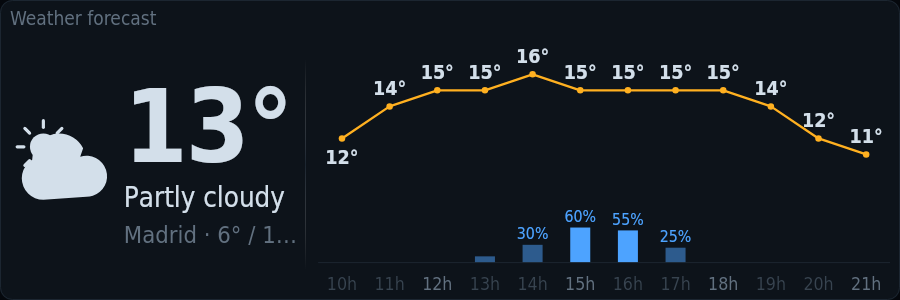

# tessera-plugin-weather

Weather from Open-Meteo, shared with every widget, and a forecast card.

A plugin for [Tessera](https://github.com/Loksly/tessera), the widget mosaic for small USB LCD panels.



## Install

In Tessera, **Plugins → Install from npm** → `tessera-plugin-weather`, then restart Tessera. Or from a terminal:

```sh
npm install --prefix ~/.config/tessera/plugins tessera-plugin-weather
```

(macOS: `~/Library/Application Support/Tessera/plugins`, Windows: `%APPDATA%\Tessera\plugins`.)

## Requirements

- Your location in Tessera → Settings (Open-Meteo, no key needed).

## Widgets

### Weather forecast — `weather/forecast`

Temperature and sky now, the next hours (temperature curve and rain) and days, and the moon when there is room.


Uses: `weather/current`.

| Option | Type | Default | |
|---|---|---|---|
| `hours` | boolean | `true` | Next hours |
| `days` | boolean | `true` | Next days |
| `moon` | boolean | `true` | Moon phase. Only on wide tiles. |

## Data sources

### Current weather — `weather/current`

Now and the next hours and days, from Open-Meteo (no key needed), for your location or the place set here. Read every 15 min while a widget uses it. Options are set once in Tessera → Settings → Data sources.

| Option | Type | Default | |
|---|---|---|---|
| `name` | string | `""` | Place name. Empty: the one in Settings. |
| `latitude` | number | `0` | Latitude. 0 and 0: use the location in Settings. |
| `longitude` | number | `0` | Longitude |

## Development

```sh
npm install
npm test          # node:test
npm run check     # TypeScript
npm run build     # dist/index.js, what Tessera loads
```

To try it in a running Tessera without publishing: `tessera plugins link .` and restart Tessera.

Working on Tessera and its plugins together: clone them side by side
(`tessera/` and `tessera-plugins/tessera-plugin-weather/`) and run `npm install` in
`tessera/`; its workspaces link every plugin found in `../tessera-plugins`.

## License

MIT
